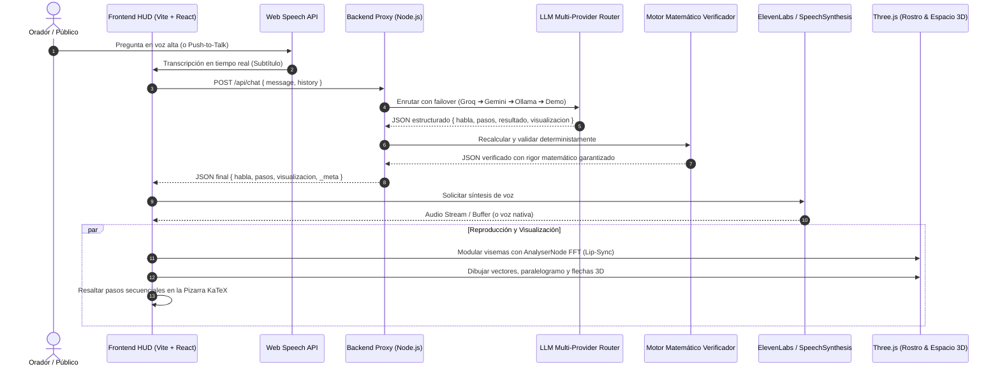

# DOCUMENTO DE ARQUITECTURA TÉCNICA // SISTEMA VECTRA
**Asistente Holográfico de Álgebra Vectorial y Geometría Analítica**

---

## 1. Visión General del Sistema
VECTRA es un asistente conversacional diseñado específicamente para presentaciones en vivo y ambientes educativos de alto impacto. Integra tres subsistemas sincronizados a 60 FPS:
1. **Rostro Holográfico 3D en Three.js**: malla geométrica con seguimiento visual, emociones procedurales y deformación de visemas labiales conectada a un analizador FFT en tiempo real.
2. **Pizarra KaTeX de Desarrollo Analítico**: renderizado secuencial paso a paso de fórmulas matemáticas con tipografía de alto contraste legible a distancia.
3. **Espacio Tridimensional Vectorial**: motor WebGL que dibuja en tiempo real vectores, paralelogramos de suma, arcos angulares, proyecciones ortogonales y planos en el espacio.

---

## 2. Diagrama de Flujo de Datos

---

## 3. Cadena de Failover del Router Multi-Proveedor (7 Niveles)

| Nivel | Proveedor | Latencia Típica | Rol y Características |
| :---: | :--- | :---: | :--- |
| **1** | **Groq Cloud (Llama 3.3 70B)** | 400 - 800 ms | Principal por velocidad extrema y razonamiento avanzado. |
| **2** | **Google Gemini 2.0 Flash** | 600 - 1000 ms | Respaldo de alta capacidad y ventana de contexto amplia. |
| **3** | **OpenRouter (Modelos `:free`)** | 800 - 1500 ms | Rotación de modelos libres de la comunidad. |
| **4** | **Mistral La Plateforme** | 700 - 1200 ms | Excelente razonamiento en lenguajes romances (español). |
| **5** | **NVIDIA NIM** | 800 - 1400 ms | Microservicios optimizados para inferencia acelerada. |
| **6** | **Ollama Local (`localhost:11434`)** | 1000 - 2500 ms | **100% Offline**, no requiere internet ni consume cuotas de API. |
| **7** | **Modo Demo Offline** | < 10 ms | Respuestas pregrabadas garantizadas para las 15 preguntas de demo. |

---

## 4. El Motor Matemático Verificador
A diferencia de los asistentes genéricos donde el modelo de lenguaje inventa los números, en VECTRA el LLM solo redacta la explicación didáctica:
1. `naturalParser.js` analiza la consulta del usuario y extrae los vectores $\vec{v} = \langle x, y, z \rangle$ y la operación solicitada.
2. `vectorEngine.js` ejecuta la operación exacta mediante aritmética euclidiana de punto flotante de alta precisión.
3. Si los cálculos del LLM discrepan del resultado analítico, el motor sobreescribe los números, genera los pasos KaTeX y asegura que la escena 3D dibuje las coordenadas verdaderas.
